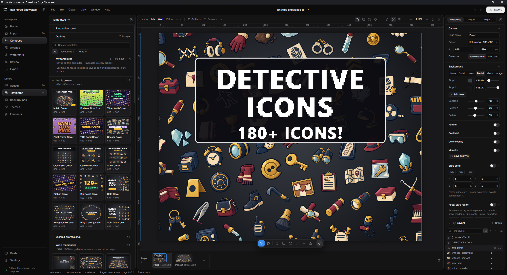
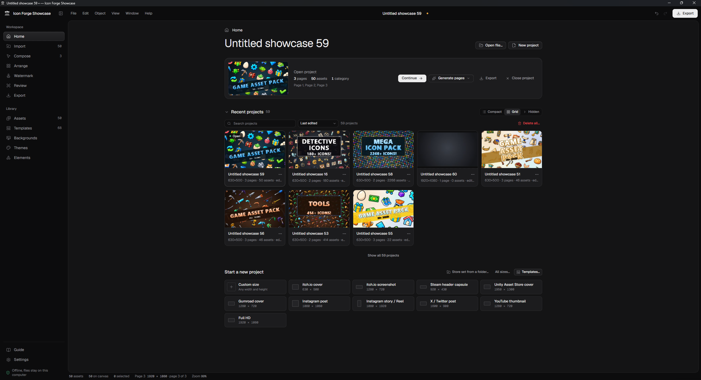
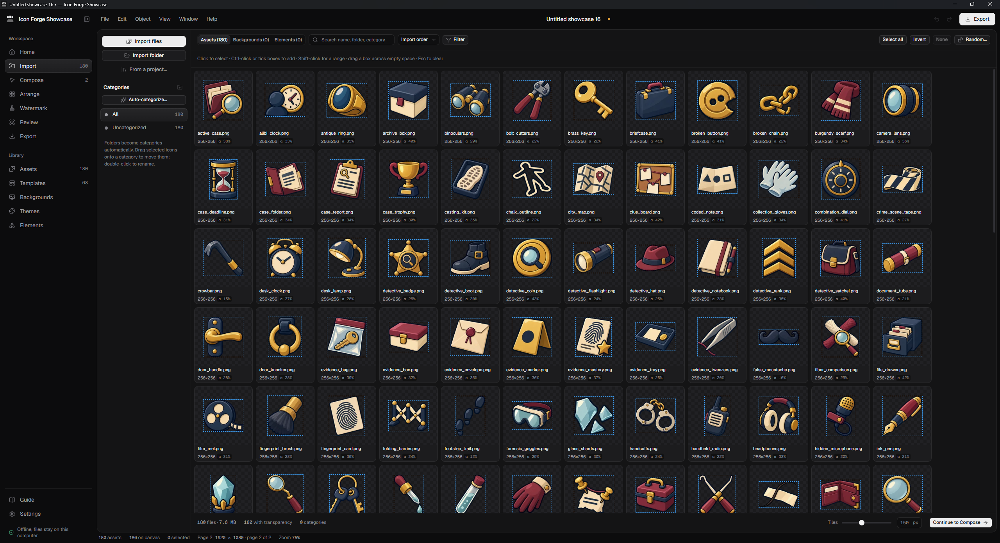
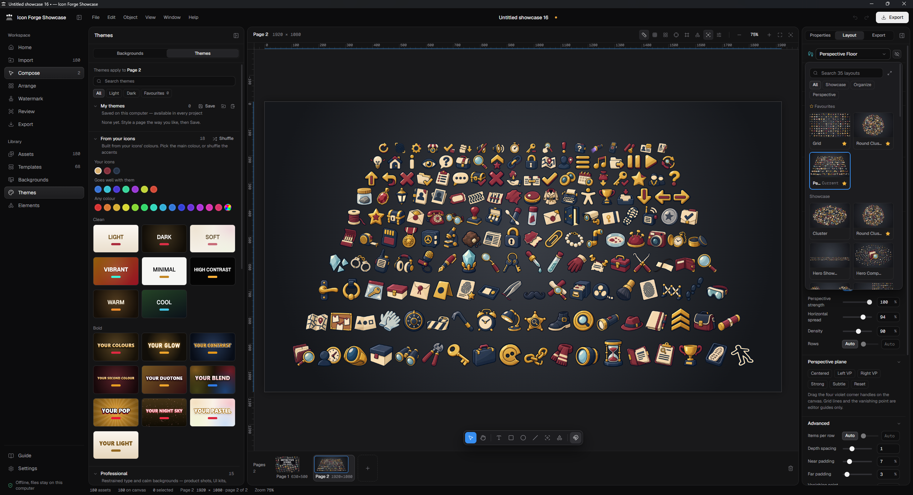

# Icon Forge Showcase

**Turn a folder of game icons into store-ready marketplace images.** Drop in your transparent PNGs and
get itch.io covers, wide thumbnails, social posts, banners, free-demo covers and full catalogs,
laid out for you and editable down to the last pixel.

It is a desktop app for Windows that works entirely offline: no account, no uploads, no telemetry.

> **Status: alpha.** Usable day to day, but expect rough edges. Keep `.showcase` backups of important
> work (Ctrl+S saves one).



## What it does

- **A whole store set in one click.** *Complete store set* builds a hero image, a square cover, a
  numbered catalog and a page per category from your pack, in one consistent look. *Custom store set*
  lets you choose the pages.
- **71 templates that fill themselves in.** Covers, thumbnails, banners, social formats, free-demo
  pages and catalogs, previewed with your own icons. The ones that suit your pack are listed first.
- **35 layouts that understand your icons.** Grids, clusters, honeycombs, rings, perspective floors
  and more, all arranged by each icon's *visible* pixels, not its file size.
- **59 themes, plus themes made from your icons' colours,** with a contrast check so titles stay
  readable on whatever is behind them.
- **A real editor underneath.** Move, scale and rotate anything; add text, badges, shapes and
  backgrounds; undo freely. Generated pages are ordinary pages.
- **Clean exports.** PNG, WebP or JPEG at 1×, 2×, 4× or a custom scale, rendered fresh from your
  original files, in batches with a naming pattern. Existing files are never overwritten.
- **Review before you publish.** Platform crops, store-card mock-ups, an optional watermark and
  composition warnings with one-click fixes.

The full list is in [docs/features.md](docs/features.md).

## Screenshots

| | |
| --- | --- |
|  **Home:** projects, recent work, new-project sizes |  **Import:** bring in icons and sort them into categories |


**Themes and layouts:** restyle a page and pick from dozens of layouts.

## Install

Icon Forge Showcase runs on **Windows 10 or 11 (64-bit)**, the only platform it is developed and
tested on.

### Portable build

If the [Releases page](https://github.com/sowndcode/Icon-Forge-Showcase/releases) lists a release
with a `.zip` under **Assets**:

1. Download the ZIP and extract it to a folder you can write to, such as
   `Documents\Icon Forge Showcase`. Avoid `C:\Program Files` and don't run it from inside the ZIP:
   projects are saved in a `data` folder next to the app.
2. Double-click **`IconForgeShowcase.exe`**.
3. The builds are not code-signed, so Windows SmartScreen may say *"Windows protected your PC"*.
   Choose **More info**, then **Run anyway**. Only do this for a ZIP downloaded from this
   repository's Releases page.

Nothing else needs to be installed. To remove the app, delete its folder, which also deletes the
projects in `data`, so back up what you want to keep first.

### From source

If no release has a ZIP yet, or you want the latest code. You need
[Node.js](https://nodejs.org/) 20.19+ or 22.12+ and about 500 MB of disk space. An internet
connection is needed for the first install only.

```bash
git clone https://github.com/sowndcode/Icon-Forge-Showcase.git
cd Icon-Forge-Showcase
npm ci
npm run app
```

Afterwards you can also start it with **`Start Icon Forge Showcase.bat`**. To update, run `git pull`
and then `npm ci`; your `data/` folder is never touched by Git.

## Your data stays on your computer

- **Offline by design.** Images are decoded locally, and the desktop app blocks all network
  requests. There are no accounts, telemetry, cloud or AI services.
- **Plain files next to the app.** Projects, original images, autosaves and settings live in the
  `data` folder beside the executable, so the whole app can be moved or backed up as one folder.
- **Hard to lose work.** Projects autosave with earlier versions kept, damaged files are set aside
  rather than deleted, and deleted projects go to a Trash you can restore from.
- **Careful with files from others.** Share codes, template files and `.showcase` projects are
  validated before anything is added.

Details: [docs/data-and-storage.md](docs/data-and-storage.md) for the folder layout, recovery and
updating, [SECURITY.md](SECURITY.md) for reporting a problem.

## Known limitations

- **Alpha:** the project format may still change. Old projects are migrated when it does, but keep
  `.showcase` backups of important work.
- **Windows only.** The code is cross-platform Electron, but other systems are untested.
- **Fonts:** templates use fonts installed with Windows (Segoe UI, Bahnschrift, Impact…). Other
  systems substitute similar fonts, so layouts can look different. Custom fonts can be imported per
  project.
- **The app folder must be writable.** If it isn't, the app warns you and saves to your user profile
  for that session.
- **No auto-update and no signed builds.** Updating means downloading the new ZIP; see
  [RELEASING.md](RELEASING.md).

## Development and contributing

The project is in active development, and feedback shapes what comes next: bug reports, ideas and
pull requests are welcome.

- [docs/development.md](docs/development.md): commands, checks and a map of the source tree.
- [CONTRIBUTING.md](CONTRIBUTING.md): how to report a bug or propose a change.
- [CHANGELOG.md](CHANGELOG.md): what changed in each version.

Please report security problems privately, as described in [SECURITY.md](SECURITY.md), not in a
public issue.

## Support the project

If you find Icon Forge Showcase useful and would like to support its development, have a look at my
[itch.io page](https://sownddddd.itch.io/).

## License

[MIT](LICENSE). Third-party components are listed in [THIRD_PARTY_NOTICES.md](THIRD_PARTY_NOTICES.md).
