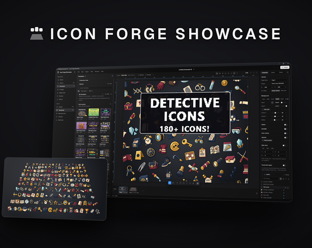
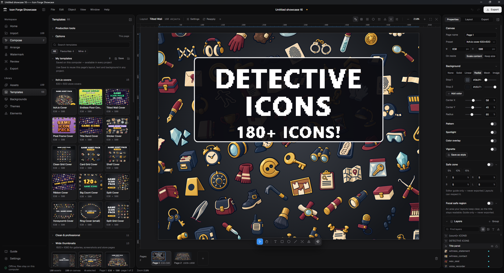
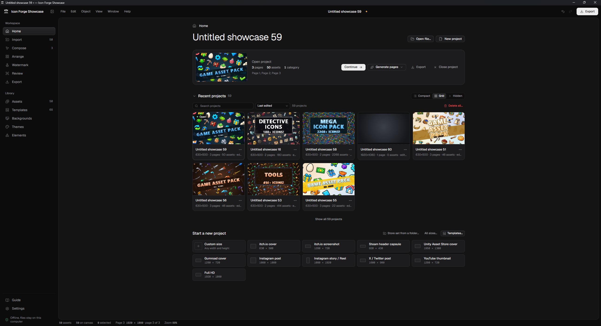
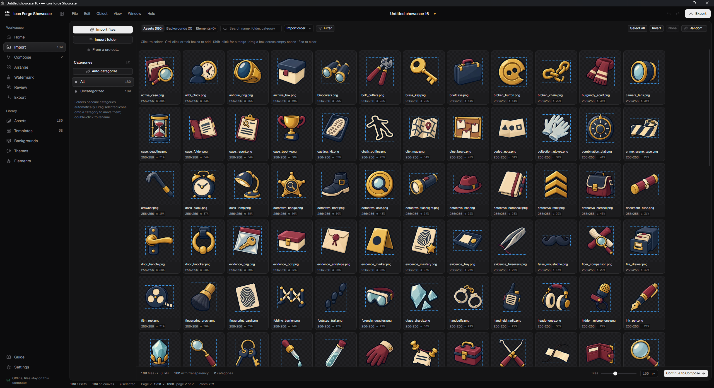
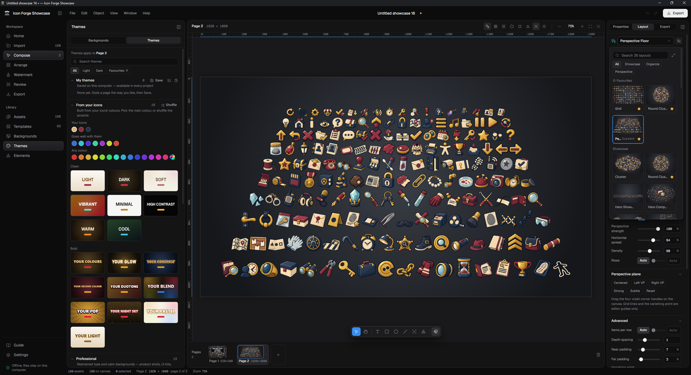

<p align="center">
  
</p>

<h1 align="center">Icon Forge Showcase</h1>

<p align="center">
  <b>Make store covers, thumbnails and catalogs for your game icon packs in minutes.</b><br>
  A free, offline desktop app for Windows that lays out your icons for you.
</p>

<p align="center">
  <a href="https://sownddddd.itch.io/icon-forge-showcase"><b>itch.io page</b></a> ·
  <a href="docs/features.md">All features</a> ·
  <a href="docs/CHANGELOG.md">Changelog</a> ·
  <a href="#download-and-install">Download</a>
</p>

---

Selling an icon pack means making the same images over and over: a cover, a few wide thumbnails, a
catalog of every icon, a post for social media. Icon Forge Showcase builds them from your folder of
PNGs. You pick a template, it places every icon by its visible pixels, and you export store-ready
images. Everything stays editable, and nothing leaves your computer.

## What you can make

- **Store covers and thumbnails** that stay readable at the small sizes stores show in search.
- **Wide banners and headers** for store pages, Steam capsules and YouTube.
- **Full catalogs** of every icon, grouped by category and numbered, up to 4K.
- **Free-demo covers** with a FREE DEMO badge and the size of the full pack.
- **Game UI mockups** that show your icons in an inventory, on a hotbar, or at real pixel sizes.
- **Square, portrait and story formats** for social posts.

Exact sizes are built in for:

| | |
|---|---|
| **Marketplaces** | itch.io, Steam, Unity Asset Store, Fab (Unreal), Gumroad, Etsy |
| **Social media** | Instagram, TikTok, X, Facebook, Pinterest, Reddit, Bluesky, LinkedIn, Discord, Patreon |
| **Video** | YouTube, Twitch |

Or any custom size, from a 320 px panel to a 4K catalog.



## How it works

1. **Import** a folder of transparent PNG or WebP icons. Subfolders become categories.
2. **Pick a template**, or let *Complete store set* build a hero image, cover, catalog and category
   pages in one matching look.
3. **Adjust** anything in the editor: text, layout, theme, icon size, background.
4. **Export** PNG, WebP or JPEG at 1×, 2× or 4×, rendered fresh from your original files.

## Why it saves time

- **77 templates** fill themselves with your icons, and the ones that suit your pack size are shown
  first.
- **35 layouts** (grids, clusters, honeycombs, rings, perspective floors) space icons by what you
  can see, so padding inside your files doesn't throw the layout off.
- **59 themes** plus themes built from your icons' own colours, with a contrast check that keeps
  titles readable.
- **Facts on the images come from your files.** Icon counts, sizes, formats and names are read from
  the pack, never invented.
- **Review before you publish:** store-card previews, platform crops, an optional watermark and
  warnings for text that is too small or too close to the edge.

| | |
| --- | --- |
|  |  |
| **Home:** your projects and every common store size | **Import:** bring in icons and sort them into categories |



## Download and install

Icon Forge Showcase runs on **Windows 10 and 11 (64-bit)** and is downloaded from this repository.

### Run from source

You need [Node.js](https://nodejs.org/) 20.19+ or 22.12+ and about 500 MB of disk space.

```bash
git clone https://github.com/sowndcode/Icon-Forge-Showcase.git
cd Icon-Forge-Showcase
npm ci
npm run app
```

After the first run you can start it with `Start Icon Forge Showcase.bat`. To update, run `git pull`
and `npm ci`; your `data/` folder is never touched by Git. More in
[docs/development.md](docs/development.md).

### Portable build

Once a ZIP is published on the [Releases page](https://github.com/sowndcode/Icon-Forge-Showcase/releases),
you can skip Node.js: extract the ZIP to a folder you can write to (such as
`Documents\Icon Forge Showcase`, not `C:\Program Files`) and double-click **`IconForgeShowcase.exe`**.
The build is not code-signed yet, so Windows SmartScreen may show *"Windows protected your PC"*:
choose **More info**, then **Run anyway**, but only for a ZIP from that page.

## Private by design

The app works fully offline and blocks network requests: it has no account, cloud or telemetry.
Projects, original images, autosaves and settings live in the `data` folder beside the app, so you
can back up or move everything as one folder. Projects autosave with earlier versions kept, and
deleted projects go to a Trash you can restore from. Details in
[docs/data-and-storage.md](docs/data-and-storage.md).

## Current status

Icon Forge Showcase is in **alpha**: it is usable every day, but expect rough edges.

- Keep `.showcase` backups of important work (Ctrl+S saves one). The project format may still change;
  older projects are migrated when it does.
- Windows is the only tested platform.
- Templates use fonts that come with Windows. You can import your own fonts per project.
- There is no auto-update yet: update with `git pull`, or download the newest ZIP.

## Support the project

Icon Forge Showcase is free. I make and sell game icon packs on [itch.io](https://sownddddd.itch.io/),
and buying one is the most direct way to support the app right now. More ways to support the project
will be added in the future.

## Feedback and contributing

Bug reports, ideas and pull requests are welcome. See [CONTRIBUTING.md](.github/CONTRIBUTING.md) to get
started and [docs/development.md](docs/development.md) for the source tree and checks. Please report
security problems privately as described in [SECURITY.md](.github/SECURITY.md).

## License

[MIT](LICENSE). Third-party components are listed in [docs/THIRD_PARTY_NOTICES.md](docs/THIRD_PARTY_NOTICES.md).
